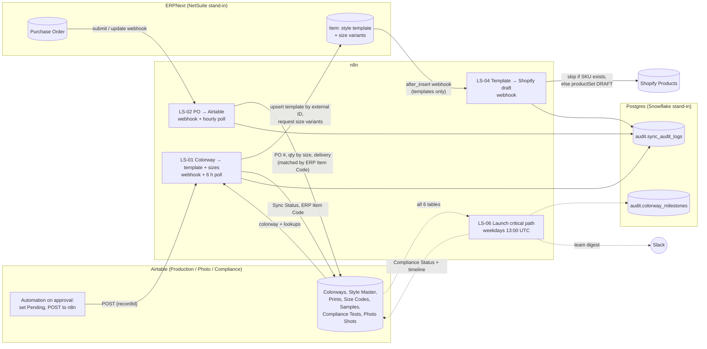
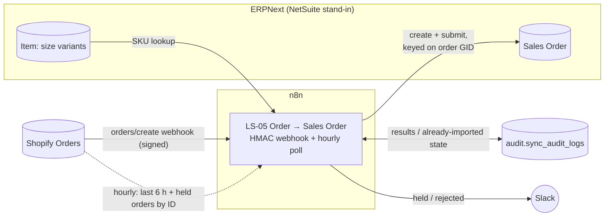
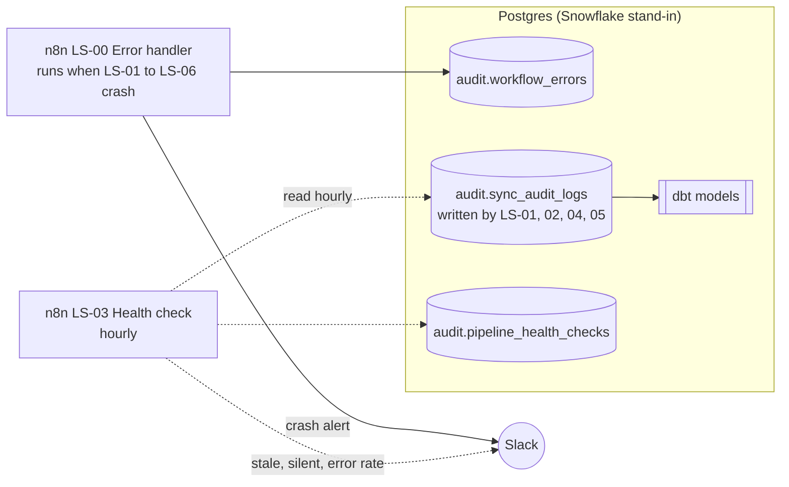
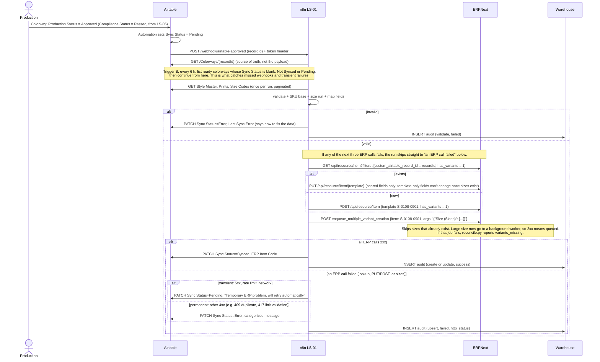

# Architecture

## Context

Production, Photography and Compliance run style development in **Airtable**. Finance and Inventory need those styles as **items in the ERP** (NetSuite in real life, ERPNext here) before they can raise purchase orders. Production then wants **PO quantities and delivery dates** back in Airtable without logging into the ERP. Analytics wants an **event history** to measure the process.

Without integration, someone re-keys each approved style into the ERP, and someone else copies PO dates back into Airtable. That's slow, error-prone (SKU typos, wrong cost), and invisible when it goes wrong.

## System diagrams

Three views of the same system, split so each one stays readable. In all three, arrows show which way data moves. **Solid** arrows are event-driven: a webhook, or a call made while handling one record. **Dotted** arrows are scheduled runs.

### 1. Product flow: colorway → ERP → Shopify

### 2. Orders: Shopify → ERP

### 3. Monitoring

LS-00 isn't wired to any system: n8n runs it automatically whenever LS-01 to LS-06 crashes. `reconcile.py` (RUNBOOK §6, *Reading the drift report*) is a script, not a workflow, so it isn't drawn here.

## LS-01 sequence (style approved → SKU in ERP)

## Field mapping: Airtable Colorway → ERPNext style template (+ size variants)

| Airtable | ERPNext | Transform |
|---|---|---|
| Colorway record id | `custom_airtable_record_id` | external ID (read-only in UI) |
| Style.Division + Style.Style Number + Colorway Number | `item_code` (= `name`) | **SKU base** `S-0108-0901` (S/D/O + 4 + 4 digits) |
| Colorway | `item_name` | e.g. "Midnight Moons Zippy" (the storefront's title pattern) |
| Style.Division | `item_group` | Sleep / Play / Other |
| Style.Size Run → Size Codes | variants via Item Attribute `Size (Division)` | one variant per size: `S-0108-0901-10` (abbreviation = real size code); `custom_size_run` keeps the order |
| Cost Price | `valuation_rate` | strip `$ ,`, positive, 2 dp |
| Style.Retail Price | `custom_retail_price` | → Shopify variant price (LS-04) |
| Print.Slug / Print Category | `custom_print_family` / `custom_print_category` | → Shopify tags `print_family:`, `print_category:` |
| Style.Product Type / Fabric / Fiber Content / Compliance Profile | `custom_product_type` / `custom_fabric_type` / `custom_fiber_content` / `custom_compliance_profile` | |
| Launch Date / Merch Date | `custom_launch_date` / `custom_merch_date` | → Shopify tags `launchMMDDYY` / `merchMMDDYY` |
| Inventory Tier / Limited Edition / Purchase Limit | `custom_inventory_tier` / `custom_limited_edition` / `custom_purchase_limit` | |
| Production Status + Compliance Status | n/a | **gate**: Approved for Production AND Passed |

Variants inherit every `custom_*` field from the template (ERPNext Item Variant Settings), so editing the template updates all sizes. That's NetSuite's matrix parent/child behaviour.

## Field mapping: ERPNext Purchase Order → Airtable Colorway

| ERPNext | Airtable | Transform |
|---|---|---|
| `name` | PO Number | |
| `items[].qty` (size variants) | PO Qty | summed across the colorway's sizes |
| `items[].item_code` + qty | PO Size Breakdown | e.g. "Preemie ×100, 3T ×50" (size code → label) |
| `items[].schedule_date` | Expected Delivery | earliest across lines |
| `supplier` | Vendor | |
| `status` | PO Status | |
| variant code → SKU base | n/a (lookup) | match on `{ERP Item Code}` |

## Design decisions (ADR-lite)

Each decision records the *why* and the *trade-off*.

**D1. Webhook for speed, poll as a safety net.**
Webhooks give near-real-time sync, but they get lost (tunnel down, quota hit, receiver deploying). A low-frequency poll of "approved but not synced" records guarantees eventual consistency. *Trade-off:* extra API calls, and the poll has to be idempotent (it is: see D3). Poll frequency is tuned to Airtable's free-plan API budget.

**D2. Webhook carries only an ID. The receiver re-fetches.**
"Thin" events: the payload says *something changed*, and the API says *what it is now*. This prevents stale or out-of-order payloads from overwriting newer data, and limits what a spoofed request can do. *Trade-off:* one extra GET per event.

**D3. Idempotent upsert keyed on an external ID.**
Look up the Item by `custom_airtable_record_id`, then update or create. Retries, duplicate webhooks and webhook + poll races all converge on the same result. This is NetSuite's `externalId` / `eid:` upsert pattern. *Trade-off:* one extra lookup per record. In NetSuite, a single `PUT …/eid:{id}` does both steps.

**D4. Validate before calling the ERP, and report every problem at once.**
Data-quality failures are the most common failures and the cheapest to fix at the source. Reporting all of them (not just the first) saves round trips with Production. Validation rules are pure functions with unit tests shared between JS and Python.

**D5. Every outcome is written back and logged. Nothing fails silently.**
The user sees the status where they work (Airtable *Sync Status* / *Last Sync Error*). Ops sees it in an append-only audit table that powers SLA queries. Crashes go to an error workflow, and silence is caught by a freshness check (D7).

**D6. Categorize errors and retry only what can heal.**
5xx, network and 429 errors are transient: the record goes back to *Pending* and the safety-net poll retries it. 4xx errors are deterministic: *Error* with a human-readable reason (409 duplicate, 417 validation, 401 auth). An end-to-end test showed that n8n's *Retry On Fail* is ignored on nodes that use an error output, so retries are status-driven rather than node-driven. That also makes them durable across n8n restarts. Python's POST is never auto-retried, because a timed-out create may have succeeded. Idempotency (D3) handles that case instead.

**D7. Monitor for silence, not just errors.**
A pipeline that stops running has a 0 % error rate. LS-03 checks *time since last success* and *volume*, as well as error rate.

**D8. Least-privilege service account.**
A dedicated ERPNext integration user with token auth and scoped roles, never Administrator. Keys can be rotated without touching a human's login, and audit logs attribute every change to "integration".

**D9. Workflows as code.**
Code-node logic lives in `n8n/src`, is unit-tested, and is compiled into workflow JSON with fixed IDs. Changes are reviewable in git, and a fresh instance can be rebuilt from the repo. *Trade-off:* small UI edits must be exported back, or they'll be overwritten on the next import.

**D10. Reconciliation as the backstop, report-only.**
Event-driven syncs drift over time (manual ERP edits, missed events). A nightly reconcile lists differences, but it doesn't auto-fix. Choosing the winner needs a human who knows which system is right.

**D11. Verify before you trust, and key on the right ID.** Shopify webhooks are HMAC-verified over the raw body before any processing. Orders are keyed on the GID string, because the numeric `id` exceeds JavaScript's safe-integer range and gets silently rounded.

**D12. Hold, don't guess.** An order with an unknown, missing or disabled SKU is never partially imported or mapped to a placeholder item. It's held with a precise reason, alerted once, and retried quietly by the poll after the master data is fixed. A wrong order in the ERP costs more than a late one.

**D13. Create, then submit.** ERP documents are created as drafts and submitted with a second call. In ERPNext v16, a document inserted already-submitted in one call keeps a stale status. I found this by checking the real records rather than trusting the HTTP 200. Splitting the steps also makes room for a "review before submit" option.

## Product model v2 (from the public storefront)

Little Sleepies sells a **print** across many **styles** (zippy, two-piece set, women's pants…), each in a **size run**. The unit everything happens to (sampling, testing, photography, approval, sync) is the **colorway** = style × print. SKUs are `DIVISION-STYLE-COLORWAY-SIZE` (`S-0108-0665-10`). The Airtable model mirrors that: Style Master and Prints link to Colorways, and Samples, Compliance Tests and Photo Shots hang off each colorway. See `airtable/SCHEMA.md`.

**D14. Timelines are computed, not typed.** The goal is tighter timelines for Photography, Compliance & Integrity and Production. LS-06 derives every colorway's critical path from the work records the teams already keep (sample decisions, test results, shot deliveries), so status can't go stale. Nobody has to remember to update a "status" field. Lead times are configuration in `shared/product_model.json`.

**D15. Alert per problem, not per record.** One digest grouped by owning team, worst lateness first, with a cap per team. The same lesson as the Shopify alert storm: 40 late colorways for one team is one message.

**D16. Write only what changed.** LS-06 diffs computed fields against Airtable and patches only changes, in batches of 10. API budget and record history both stay clean.

**D17. Model sizes the way the ERP does: template + variants.** A colorway is an ERPNext template (NetSuite: matrix parent), and each size is a variant with the real SKU. ERPNext builds the variant code from the template code plus the attribute abbreviation, so the size codes themselves are the abbreviations. The same label has different codes per division, so there's one attribute per division. Variants are created by ONE call per colorway (ERPNext skips sizes that exist; 10+ sizes go to a background worker), not one HTTP call per size from n8n. LS-04 builds Shopify variants from the template's size run, so it never races the background job.

## What would change in production

- n8n in **queue mode** (Redis + workers) with Postgres as its database. `N8N_ENCRYPTION_KEY` stored in a secret manager and backed up.
- TLS, an IP allowlist and **HMAC-signed** webhooks instead of a shared header token.
- Real NetSuite: OAuth 2.0 M2M, REST `eid:` upsert, **matrix items** (style × size), and the account-level concurrency limit shared with the Shopify connector.
- Audit events loaded into **Snowflake** (n8n Snowflake node, or S3 + Snowpipe), with dbt models feeding the Finance/Ops dashboards.
- A separate sandbox stack per environment, with workflow promotion through git.
